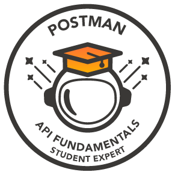
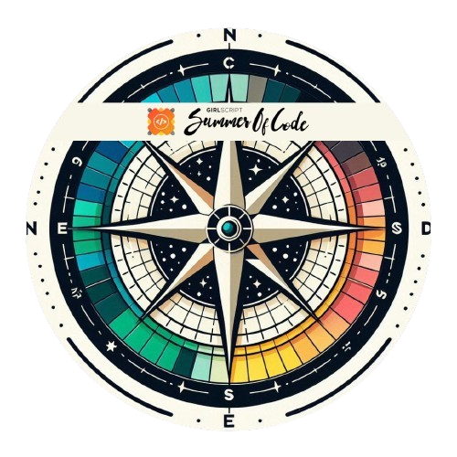



# [Hi, I'm Khushi Agrawal 👋](https://khushi-dev-lilac.vercel.app/)

**Full Stack Developer** · B.Tech CSE, KCC Institute of Technology (2022–2026) · India 🇮🇳

Building maintainable applications with clear architecture, well-organized code, reusable patterns across the stack, and reliable APIs.

---

### `PROFESSIONAL EXPERIENCE`

**Mobiloitte Technology Private Limited** · *Full Stack Developer Intern*  
June 2026 – October 2026 · B.Tech CSE completed 2026

- Tested company and professional websites, helping check and refine their functionality.
- Built complete projects from scratch using BRDs to guide implementation, preparing them for production and deploying them to staging.
- With manager guidance, learned production-readiness practices for handling application load, optimizing and reusing code, and choosing appropriate data-storage approaches.
- Also learned project-specific validation rules and word limits, admin-panel security, and systematic error diagnosis and resolution.
- Supported debugging, end-to-end testing, and performance optimization; used AI-powered tools to support development workflows.

### `OPEN SOURCE & AVAILABILITY`

- GSSoC Open Source Contributor; reviewed and merged open-source pull requests through community contributions.

> **🟢 Open to software engineering and technology roles aligned with my skills**

### `TECHNICAL EXPERTISE`

- **Languages:** `JavaScript (ES6+)` · `TypeScript` · `C++`
- **Frontend:** `React.js` · `Next.js` · `HTML5` · `CSS3` · `Tailwind CSS`
- **Backend & integrations:** `Node.js` · `Express.js` · `REST APIs` · `OpenAI API` · `Gemini API`
- **Databases:** `MongoDB` · `SQL`
- **Authentication & access:** `JWT` · `OTP` · `RBAC` · `HttpOnly Cookies`
- **Application security:** `CSRF Protection` · `XSS Sanitization` · `Zod Validation`
- **Tools & deployment:** `Git` · `GitHub` · `Postman` · `Vercel` · `Render` · `Railway`

### `ACHIEVEMENTS`

| Milestone | Detail |
|:--|:--|
| **500+ DSA problems** | Solved on LeetCode and GeeksforGeeks |
| **5-Star HackerRank** | Programmer badge |
| **GFG 160-Day Challenge** | Completed with certificate |
| **GirlScript Summer of Code** | Contributor |
| **HCL Certified** | Full Stack Web Development |

### `COMMUNITY BADGES`

  
  &nbsp;&nbsp;
  

---

**Open to interesting conversations, collaborations, and new opportunities.**

[LinkedIn](https://linkedin.com/in/khushi-agrawal-08a21b25a/) · [Instagram](https://instagram.com/khushi_agrawal7589) · [Discord](https://discord.com/channels/@me) · [Email](mailto:khushi4608@gmail.com) · [Portfolio](https://khushi-dev-lilac.vercel.app/)

